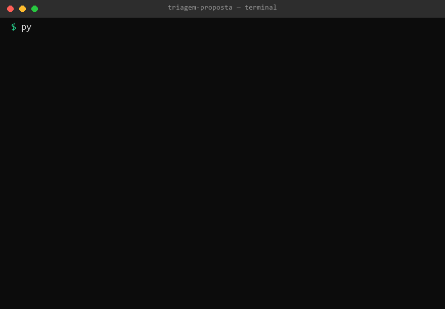

# triagem-proposta

Triagem de propostas de recuperação de pastagens degradadas — meu teste prático para a vaga de Desenvolvedor(a) de Sistemas e Processos de IA (AgDev).



A skill recebe a proposta em JSON, aplica as regras R1–R6 **em código Python puro** (nada de "o modelo acha") e devolve um parecer — **SEGUE**, **RECUSADA** ou **REVISÃO HUMANA** — com todos os motivos, as pendências e um card em Markdown pronto para virar tarefa no gerenciador.

Quando a proposta cai em RECUSADA e REVISÃO HUMANA ao mesmo tempo, vale RECUSADA — mas todos os motivos entram no relatório.

## Rodar em 1 minuto

Só precisa de Python 3.10+. Nenhuma dependência para usar; `pytest` só para rodar os testes.

```bash
git clone <este repositório>
cd triagem-proposta
python -m triagem exemplos/P-001.json
```

A saída junta o parecer em JSON e o card:

```
===== exemplos\P-001.json =====
{
  "esquema": "triagem-proposta/1",
  "proposta_id": "P-001",
  "parecer": "SEGUE",
  ...
}
# Triagem P-001
**Parecer: SEGUE**
...
```

Flags: `--json` (só o parecer), `--card` (só o card). Aceita vários arquivos, uma pasta inteira (`python -m triagem exemplos/`) ou stdin (`-`).

## Os 5 exemplos do enunciado

| Proposta | O que exercita | Parecer |
|---|---|---|
| `exemplos/P-001.json` | tudo dentro da regra | **SEGUE** |
| `exemplos/P-002.json` | 60 ha < 100 ha (R1) | **RECUSADA** |
| `exemplos/P-003.json` | divergência matrícula × CAR de 11,11% (R5) | **REVISÃO HUMANA** |
| `exemplos/P-004.json` | alerta de desmatamento em 2023 (R2) + CAR "Pendente" (R3) | **RECUSADA**, com os dois motivos listados |
| `exemplos/P-005.json` | área da matrícula ausente (R6) + cadastro "Pendente de regularização" (R4) | **REVISÃO HUMANA** |

Os casos de borda ficam em `exemplos/borda/`: 100 ha exatos, alerta no próprio dia do corte, divergência de exatamente 5%, CAR escrito minúsculo com espaços, área negativa, objeto vazio, alerta ilegível…

## Mapa: cada ponto do enunciado → onde está travado

| Ponto do enunciado | Onde está garantido |
|---|---|
| R1 — "pelo menos 100 ha" (100 passa, 99,9 não) | `TestR1AreaDegradada` · `borda/area_100ha_exata.json` |
| R2 — 01/01/2020 não recusa; 02/01 recusa; nulo, data ou lista | `TestR2AlertaDesmatamento` · `borda/alerta_*` |
| R2 — alerta ilegível ou com data no futuro → revisão citando o valor | `TestR2AlertaDesmatamento` · `borda/alerta_ilegivel.json` · `borda/alerta_no_futuro.json` |
| R3 — normaliza maiúsculas/espaços; fora da lista → revisão com o valor | `TestR3SituacaoCar` · `borda/car_*` |
| R4 — só "Regular" passa; qualquer outra → revisão | `TestR4SituacaoCadastral` · `borda/cadastral_pendente.json` |
| R5 — exatamente 5% passa (nos dois sentidos) | `TestR5MatriculaVsCar` · `borda/divergencia_*` |
| R6 — os 7 campos; nulo = ausente; alerta nulo = sem alerta; tipos quebrados | `TestR6ValidarCampos` · `borda/*ausentes*` |
| Recusa + revisão juntas → vale RECUSADA, lista tudo | `TestDecisaoCombinada` · `P-004.json` |
| Parecer de cada arquivo de exemplo, um a um | `tests/test_exemplos.py` |

## Testes

```bash
pip install pytest
pytest
```

São 188 testes cobrindo regra a regra, os limites exatos do enunciado (100 ha, 01/01/2020, 5%), valores malformados, a linha de comando e um teste de robustez que passa 300 propostas aleatórias malformadas pela triagem — nenhuma quebra, todas com parecer válido e determinístico. O CI (`.github/workflows/ci.yml`) roda tudo a cada push.

## Formato de entrada

Objeto JSON com os 7 campos do enunciado (todos obrigatórios; `alerta_desmatamento` aceita `null` = sem alerta, uma data `"AAAA-MM-DD"` ou `"DD/MM/AAAA"`, ou lista de datas):

```json
{"id": "P-001", "area_degradada_ha": 850, "area_matricula_ha": 1200,
 "area_car_ha": 1190, "alerta_desmatamento": null,
 "situacao_car": "Ativo", "situacao_cadastral": "Regular"}
```

## Formato de saída

O parecer JSON traz `parecer` (`SEGUE`, `RECUSADA`, `REVISAO_HUMANA`), `motivos` (regra + mensagem citando o valor recebido), `pendencias` (só quando dá para resolver) e `regras` (o resultado de R1–R6, uma a uma, incluindo as que ficaram "nao_avaliada" por depender de campo quebrado).

Códigos de saída: `0` = triado com sucesso (parecer é resultado, não erro); `2` = problema de entrada (arquivo ilegível, JSON inválido, não é objeto).

## Usar como skill do Claude

- **Claude Code:** copie esta pasta para `~/.claude/skills/triagem-proposta` (no Windows: `%USERPROFILE%\.claude\skills\triagem-proposta`).
- **Claude Desktop:** Configurações → Capabilities → Skills → enviar a pasta compactada (.zip).

Depois disso, "tria a proposta anexada" já dispara o fluxo: o Claude roda o script e apresenta o card — o parecer sempre vem do código, nunca do modelo.

## O opcional do enunciado: quadro de tarefas simulado

```bash
python -m triagem exemplos/P-004.json --quadro quadro.md
```

Além de imprimir, anexa a proposta como tarefa no fim do `quadro.md` — com data/hora e as pendências prontas para marcar. É a integração simulada com gerenciador de tarefas na versão mínima: nada de servidor, nada de conta; em produção, o mesmo bloco iria para a API do gerenciador.

## Limitações honestas (e os próximos passos)

- A triagem confia nos dados recebidos: não valida CNPJ nem matrícula de verdade. A validação real entra junto com as consultas do DESIGN (SICAR/PRODES/Receita).
- O alerta de desmatamento é avaliado por **dia** (hora descartada) — fuso horário e precisão horária ficam para a versão que falar com o PRODES.
- Uma proposta = um proponente; não modela sócios, condomínios ou múltiplos imóveis.
- Ainda não há trilha de auditoria: o próximo passo que eu faria é gravar cada parecer (entrada, saída e comprovantes das fontes) em JSONL, para reproduzir qualquer decisão meses depois.

## Estrutura

```
triagem-proposta/
├── SKILL.md            # a skill: quando usar e como usar
├── README.md
├── DESIGN.md           # decisões de desenho (1 página)
├── PERGUNTAS.md        # respostas da seção 8 do teste
├── run.py              # atalho para rodar de qualquer pasta
├── triagem/
│   ├── modelo.py       # tipos e constantes das regras
│   ├── regras.py       # R1–R6 e validação dos 7 campos (código determinístico)
│   ├── triagem.py      # orquestração e decisão final
│   ├── card.py         # card em Markdown
│   ├── quadro.py       # opcional do enunciado: quadro de tarefas simulado
│   └── cli.py          # linha de comando
├── exemplos/           # os 5 do enunciado + borda/
└── tests/              # pytest: regras, integração, card, CLI e robustez
```
